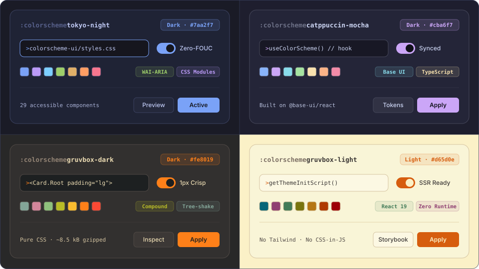

# colorscheme-ui

[](https://www.npmjs.com/package/colorscheme-ui)
[](https://www.npmjs.com/package/colorscheme-ui)
[](https://github.com/externuz/colorscheme-ui/actions/workflows/ci.yml)
[](https://externuz.github.io/colorscheme-ui/)
[](./LICENSE)

> `:colorscheme tokyo-night` — for your React web apps.

**colorscheme-ui** is a flat, crisp, accessible React UI component library built on headless [`@base-ui/react`](https://base-ui.com) primitives, pure **CSS Modules**, and semantic CSS custom properties inspired by iconic code-editor colorschemes: **Tokyo Night**, **Catppuccin Mocha**, **Catppuccin Latte**, **Gruvbox Dark**, and **Gruvbox Light**.

<p align="center">
  <a href="https://externuz.github.io/colorscheme-ui/">
    
  </a>
</p>

- **Zero Tailwind, zero runtime CSS-in-JS** — tiny static CSS (~8.5 kB gzipped) with zero specificity wars.
- **5 iconic editor colorschemes out of the box** — instant `[data-theme]` switching with zero FOUC.
- **WAI-ARIA accessible** — focus management, keyboard navigation, and portals powered by `@base-ui/react`.
- **Flat, terminal-crisp aesthetic** — clean 1px borders, balanced contrast, zero neon glow or heavy glassmorphism.
- **Interactive Storybook** — [https://externuz.github.io/colorscheme-ui/](https://externuz.github.io/colorscheme-ui/)

---

## Installation

```bash
# Bun
bun add colorscheme-ui

# npm
npm install colorscheme-ui

# pnpm / Yarn
pnpm add colorscheme-ui
```

Peer dependencies: `react` and `react-dom` (`^18.0.0 || ^19.0.0`).

---

## Quick Start

Import the stylesheet once at your app entry point (`main.tsx` or `layout.tsx`), wrap your app in `<TooltipProvider>` (and optionally `<ToastProvider>`), and use any component:

```tsx
import 'colorscheme-ui/reset.css'; // Optional minimal modern CSS reset
import 'colorscheme-ui/styles.css'; // Semantic tokens (5 colorschemes) + component styles

import { Button, Card, Field, Input, TooltipProvider, useColorScheme } from 'colorscheme-ui';

export function App() {
  const { theme, themes, setTheme } = useColorScheme();

  return (
    <TooltipProvider>
      <Card.Root variant="elevated" padding="lg" style={{ maxWidth: 420 }}>
        <Card.Header>
          <div>
            <Card.Title>:colorscheme {theme}</Card.Title>
            <Card.Description>Switch editor palettes at runtime</Card.Description>
          </div>
        </Card.Header>

        <Card.Body>
          <Field.Root>
            <Field.Label>Workspace</Field.Label>
            <Input placeholder="core-engine" />
          </Field.Root>

          <div style={{ display: 'flex', gap: 8, flexWrap: 'wrap', marginTop: 12 }}>
            {themes.map((t) => (
              <Button
                key={t.id}
                size="sm"
                variant={t.id === theme ? 'primary' : 'secondary'}
                onClick={() => setTheme(t.id)}
              >
                {t.name}
              </Button>
            ))}
          </div>
        </Card.Body>
      </Card.Root>
    </TooltipProvider>
  );
}
```

### Zero-FOUC Theme Bootstrap

To prevent a flash of the default theme before JavaScript hydrates, place `getThemeInitScript()` inline in `<head>` (or copy the snippet into `index.html`):

```tsx
import { getThemeInitScript } from 'colorscheme-ui';

// In SSR / Next.js <head>:
<script dangerouslySetInnerHTML={{ __html: getThemeInitScript() }} />
```

You can also customize the `localStorage` key and default colorscheme on startup:

```ts
import { configureColorScheme } from 'colorscheme-ui';

configureColorScheme({
  storageKey: 'my_app_theme',
  defaultTheme: 'tokyo-night',
});
```

---

## Built-in Colorschemes

| ID (`ThemeId`)     | Mode  | Canvas    | Surface   | Primary Accent |
| ------------------ | ----- | --------- | --------- | -------------- |
| `tokyo-night`      | Dark  | `#1a1b26` | `#1f2335` | `#7aa2f7`      |
| `catppuccin-mocha` | Dark  | `#1e1e2e` | `#242538` | `#cba6f7`      |
| `catppuccin-latte` | Light | `#eff1f5` | `#f7f8fb` | `#8839ef`      |
| `gruvbox-dark`     | Dark  | `#282828` | `#32302f` | `#fe8019`      |
| `gruvbox-light`    | Light | `#fbf1c7` | `#f9f5d7` | `#d65d0e`      |

Every colorscheme exposes identical semantic CSS variables on `:root` / `[data-theme="..."]` that you can use directly in your own CSS / CSS Modules:

- **Surfaces & Borders**: `--bg-canvas`, `--bg-sunken`, `--bg-surface`, `--bg-elevated`, `--bg-input`, `--bg-hover`, `--bg-active`, `--border-subtle`, `--border-default`, `--border-strong`, `--border-focus`
- **Typography**: `--font-sans`, `--font-mono`, `--text-primary`, `--text-secondary`, `--text-muted`, `--text-on-accent`
- **Accents & Statuses**: `--accent-primary`, `--accent-primary-hover`, `--accent-subtle`, `--accent-border`, `--palette-{blue|purple|cyan|green|yellow|orange|red}`, `--status-{success|warning|danger}`
- **Geometry & Motion**: `--radius-{xs|sm|md|lg|full}`, `--transition-{fast|normal}`, `--shadow-{sm|md|lg}`

If you only want the CSS variables without the React components, import `colorscheme-ui/tokens.css`.

---

## Included Components (29)

- **Atomic Form Controls**: `Button`, `Input`, `Textarea`, `Select`, `Field`, `Fieldset`, `Checkbox`, `Switch`, `RadioGroup` + `Radio`, `Slider`, `ToggleGroup`
- **Choice Cards**: `SwitchCard`, `CheckboxCard`, `RadioCard`
- **Surfaces, Feedback & Data Display**: `Card`, `Table` (`bordered` / `plain`), `Alert`, `Avatar`, `Chip`, `Skeleton`, `Separator`, `ScrollShadow`, `Spinner`
- **Navigation, Disclosure & Overlays**: `Tabs`, `Accordion`, `Collapsible`, `Modal`, `Drawer`, `Dropdown`, `ToastProvider` + `toast`, `Tooltip` (`TooltipProvider`)
- **Utilities**: `cn`, `useColorScheme`, `configureColorScheme`, `applyThemeToDom`, `getThemeInitScript`, `THEMES`

### API Patterns & Customization

Multi-part components follow a consistent compound API (`Card.*`, `Field.*`, `Fieldset.*`, `Select.*`, `Tabs.*`, `Accordion.*`, `Collapsible.*`, `Modal.*`, `Drawer.*`, `Dropdown.*`, `Table.*`) while forwarding underlying `@base-ui/react` props, `className`, and `style`:

```tsx
import { Field, Select, ToastProvider, toast } from 'colorscheme-ui';

<ToastProvider position="bottom-right">
  <Field.Root>
    <Field.Label>Runtime</Field.Label>
    <Select.Root defaultValue="bun" onValueChange={(v) => toast.success(`Switched to ${v}`)}>
      <Select.Trigger placeholder="Select runtime..." />
      <Select.Content>
        <Select.Item value="bun" description="All-in-one JavaScript toolkit">
          Bun
        </Select.Item>
        <Select.Item value="node" description="LTS server runtime">
          Node.js
        </Select.Item>
      </Select.Content>
    </Select.Root>
  </Field.Root>
</ToastProvider>
```

Need a custom theme or slight tweak? Override any CSS custom property on `:root` or define your own `[data-theme="..."]` selector — all components adapt automatically with zero JS overhead.

---

## Development

```bash
bun install
bun run storybook       # Start local Storybook on http://localhost:6006
bun run check           # Lint (Biome) + Typecheck (tsc) + Unit Tests (Vitest)
bun run build           # Build ESM bundle, TypeScript declarations, and CSS
```

## Acknowledgments

Color palettes are inspired by the original open-source colorscheme creators:

- **[Tokyo Night](https://github.com/enkia/tokyo-night-vscode-theme)** by [Enkia](https://github.com/enkia) (MIT)
- **[Catppuccin](https://github.com/catppuccin/catppuccin)** (Mocha & Latte) by [Catppuccin Org](https://github.com/catppuccin) (MIT)
- **[Gruvbox](https://github.com/morhetz/gruvbox)** (Dark & Light) by [Pavel Pertsev (`morhetz`)](https://github.com/morhetz) (MIT/X11)

## License

[MIT](./LICENSE) © [Vladislav Kolesnikov](https://github.com/externuz)
